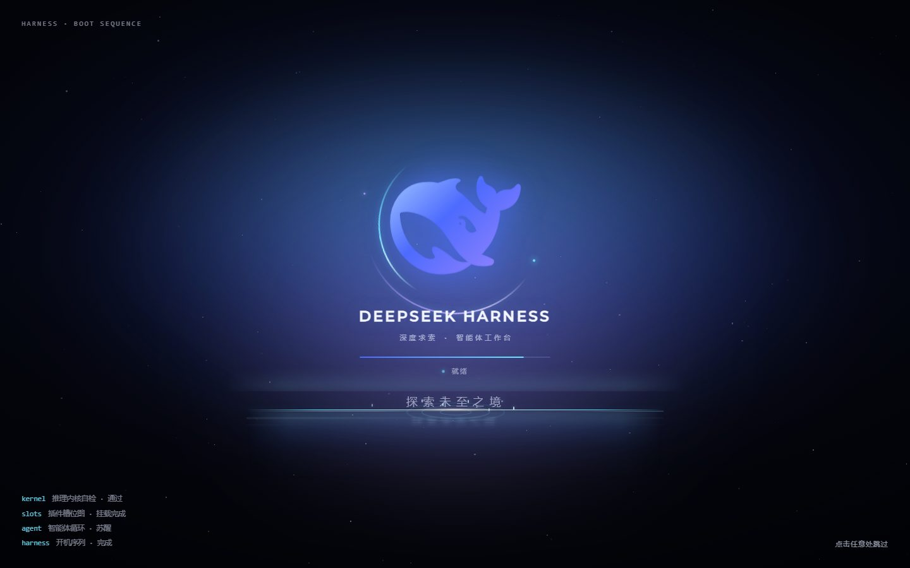
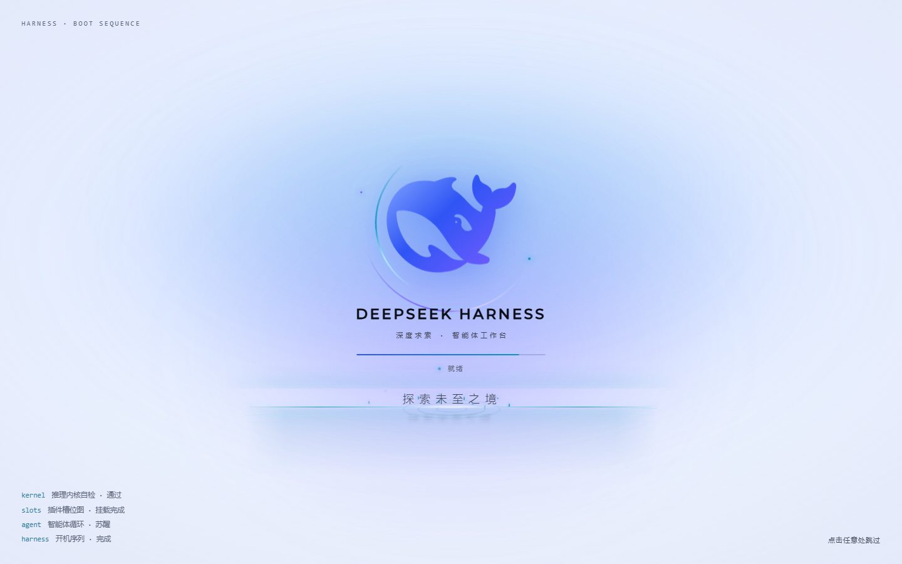

# dsh-plugin-boot-fx · 炫酷开机动画

给 [DeepSeek Harness](https://github.com/deepseek-ai/deepseek-harness) Web GUI 加一层全屏开机动画：星空 + 极光、官方鲸鱼徽标描边点亮、开机自检日志、进度条，最后一道**实体水面**亮起 —— 薄雾、逐层加深的水体、缓慢漂移的波光、弹出回落的水珠与扩散的涟漪，`探索未至之境` 六个字从水线下逐字破水涌出，水面同时浮现带波纹的倒影，应用就绪即闪白淡出。

**纯浏览器端实现**：只注册一个空的 Host 行，全部视觉在 Client half；不注册任何面板/工具，不改动应用根节点，不发送任何网络请求。






## 效果时间线（默认 1.3× 慢放）

| 时间 | 画面 |
| --- | --- |
| 0.00s | 深空背景、星空与极光淡入 |
| 0.13s | 鲸鱼徽标缩放入场，双子轨道环开始旋转 |
| 0.21s | 鲸鱼轮廓用渐变描边「画」出来（约 1.5s） |
| 0.81s | 鲸鱼填充点亮，标题逐字浮现（约 2.0s 完成） |
| 1.17s | 水面亮起：水线微光、薄雾、深层水体、三层波光、涟漪扩散 |
| 1.46s | `探索未至之境` 逐字破水涌出，约 3.08s 六字落定；水面浮现倒影与水珠/光点 |
| 1.76s | 「点击任意处跳过」提示出现 |
| 应用就绪后 | 状态变「就绪」→ 闪白 → 整层淡出；最短停留 4.03s，总时长约 4.65s |

- 深色 / 浅色主题自适应（跟随 `body[data-ds-dark-theme]`）；`prefers-reduced-motion: reduce` 退化为静态画面 + 短暂淡出。
- 点击任意处 / `Esc` / 空格 / 回车可立即跳过。
- 启动失败兜底：DSH 内置启动遮罩进入失败态时立即淡出露出错误页，不会挡住报错；另有 13s 强制超时。

## 安装

在 DeepSeek Harness 里任选一种：

- **插件市场（推荐）**：侧边栏「插件」→「Discover」，找到「炫酷开机动画」安装并启用；
- **Add plugin**：粘贴本仓库地址
  `https://github.com/LiYang19961001/dsh-plugin-boot-fx`；
- **命令行**：

```powershell
dsh plugin --profile desktop add "https://github.com/LiYang19961001/dsh-plugin-boot-fx"
```

安装后即可在下次启动 / 刷新页面时看到开机动画。

## 调速与开关

```js
__dshBootFx.setSpeed(1.0)   // 1=原速，默认 1.3 更慢；0.6~2.5，刷新后生效
__dshBootFx.speed           // 当前倍率
__dshBootFx.replay()        // 立即重播一次
__dshBootFx.off()           // 本浏览器永久关闭（localStorage）
__dshBootFx.on()            // 重新开启
```

URL 加 `?bootfx=off` 可单次关闭。

卸载：

```powershell
dsh plugin --profile desktop remove dsh-plugin-boot-fx
```

## 文件

| 文件 | 说明 |
| --- | --- |
| `client.js` | 浏览器端实现（构建产物，id 与包名一致） |
| `client.template.js` | 可编辑源文件（`__PACKAGE_ID__` / `__PACKAGE_VERSION__` / `__WHALE_PATH__` 占位符） |
| `build.mjs` | 读取 `package.json` 与 `assets/whale-path.txt`，重新生成 `client.js`、`icon.svg` |
| `index.js` | Host 半身（空实现） |
| `cordis.patch.yml` | bundle patch，插入 Host 行 `plugin-boot-fx` |
| `locale/{zh,en}.json` | 插件列表里的标题 / 描述 |
| `docs/*.jpg` | 真实 DSH Web 实例截图 |

重新构建：

```powershell
node build.mjs
```

## English

A full-screen boot splash for the DeepSeek Harness Web GUI. A starfield and aurora stage,
the DeepSeek whale mark drawing itself and lighting up, a boot log, a progress line, and
finally a physical water surface from which **探索未至之境** (explore the unexplored)
rises character by character with ripples, droplets and a rippling reflection — then the
splash flashes and fades into the app. Browser-side only, theme-aware, skippable, with a
failure fallback and a configurable pacing multiplier (`__dshBootFx.setSpeed`).

## Notes

- The DeepSeek whale mark belongs to DeepSeek; it is used here only to decorate the
  Harness boot screen, and is taken from the application's own favicon.
- Tested on DSH 0.2.1-rc.5 (desktop), Chromium 144. Visual regression: 8 + 4 + 3 rounds of
  headless frame checks plus end-to-end runs against a real DSH web instance.

## License

MIT (see [LICENSE](LICENSE)).
